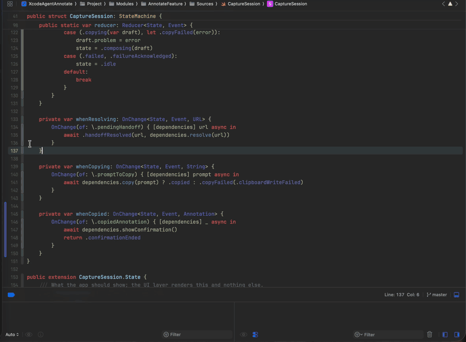
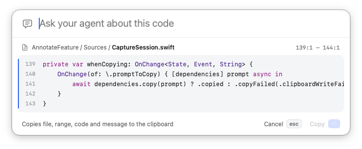
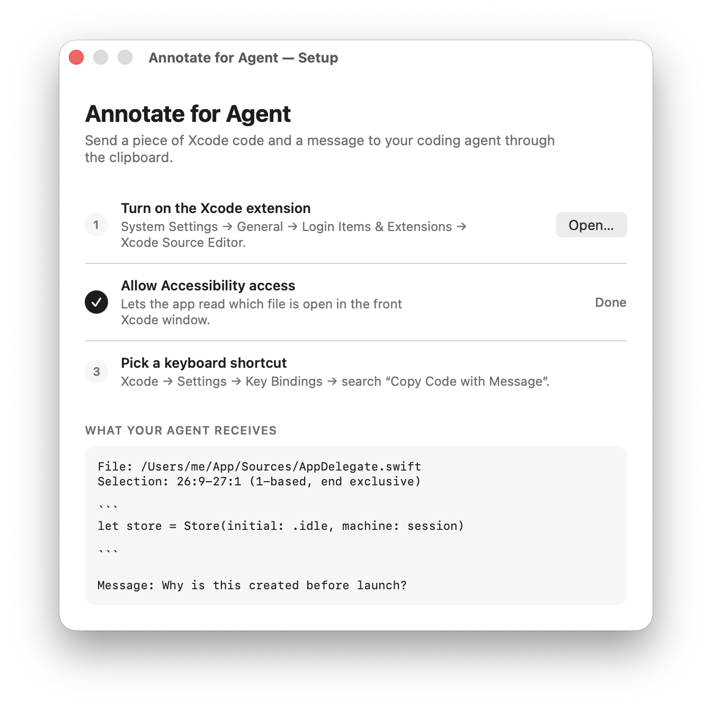

# Annotate for Agent — Xcode

Point your coding agent at exact code in Xcode. Select some code, run
**Copy Code with Message**, type what you want, and press Return. The clipboard
then holds the file path, the selected range, the code, and your message, ready
to paste into Claude Code, Codex, Cursor, or any other agent.



[Watch the full-quality demo (MP4)](screenshots/demo.mp4)

It is the Xcode counterpart of
[annotate-for-agent-vs-code](https://github.com/sergdortXM/annotate-for-agent-vs-code)
and copies the same format.

## What it does

- **Captures a selection or the current line.** If you select nothing, the line
  under the caret is used.
- **Shows what you're about to send.** A floating panel shows the file, the range,
  and the lines with syntax highlighting. The parts outside your selection are dimmed.
- **Copies a prompt your agent can act on.** Return copies and closes the panel.
  Escape cancels. A small "Copied for your agent" message confirms the copy.
- **Doesn't change your code.** It never edits files, selections, or the
  clipboard until you press Copy.



What your agent receives:

````text
File: /Users/me/Project/Sources/Greeting.swift
Selection: 12:5-13:28 (1-based, end exclusive)

```
let greeting = "Hello"
print(greeting.uppercased())
```

Message: Make this respect the user's locale
````

## Requirements

- macOS 15 or later
- Xcode

## Setup

1. Build and open **Annotate for Agent**. See
   [XcodeAgentAnnotate/README.md](XcodeAgentAnnotate/README.md) for build steps.
2. Follow the setup checklist:
   - Turn on the Xcode extension in System Settings.
   - Allow Accessibility access. This lets the app find which file is open in
     the front Xcode window; it reads nothing else.
   - Optionally, pick a keyboard shortcut in Xcode → Settings → Key Bindings
     (search for "Copy Code with Message").
3. Restart Xcode, then use **Editor → Annotate for Agent → Copy Code with Message**.



## How it works

The Xcode extension is sandboxed and can't see file paths, so it passes the
selection to the companion app. The app uses Accessibility to confirm the focused
Xcode editor shows the same text and to find its file, then shows the message
panel. Architecture, limits, and testing are covered in
[XcodeAgentAnnotate/README.md](XcodeAgentAnnotate/README.md).
